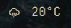

# Weather

Omarchy shell bar widget showing current weather with a detail popup. Cloned from the built-in `omarchy.weather` plugin (id: `weather`).



## Install

```bash
git clone https://github.com/dbohry/weather ~/.config/omarchy/plugins/weather
omarchy-shell shell rescanPlugins
```

Then add the widget to the bar: open the Omarchy settings panel (or run
`omarchy bar`) and enable **My Weather** under the Info category.

## Uninstall

```bash
omarchy bar remove weather   # or disable it from the settings panel first
rm -rf ~/.config/omarchy/plugins/weather
omarchy-shell shell rescanPlugins
```

The only state this plugin writes is the configured location, saved to
`~/.local/state/omarchy/settings/weather.json`. Remove that file too if you
want a completely clean uninstall.

## What it does

- Bar pill: condition icon + current temperature.
- Click: opens a popup with feels-like, wind, humidity, and a 3-day forecast.
- Click the location label in the popup to search and set a custom location (falls back to IP auto-detect when cleared).
- Auto-refreshes on a timer (`refreshMinutes` setting, default 15 minutes).

## Data sources

- [wttr.in](https://wttr.in) — current conditions and forecast fallback.
- [Open-Meteo](https://open-meteo.com) — faster current conditions + daily forecast once coordinates are known; also used for location geocoding search.

Configured location is persisted via `omarchy-weather-location` to `~/.local/state/omarchy/settings/weather.json`.

## Files

- `manifest.json` — plugin metadata (id: `weather`, settings form: `weatherSettings`)
- `BarWidget.qml` — bar pill entry point (`moduleName: omarchy.weather`, so it shares settings/IPC with the original)
- `Panel.qml` — popup detail view, location editing, refresh/retry logic
- `Model.js` — pure helpers: parsing, unit conversion, icon mapping

## Settings

- `unit` — `"metric"` or `"imperial"` (auto-detected from locale/country if unset)
- `refreshMinutes` — auto-refresh interval, minimum 1

## Requirements

- Network access to `wttr.in` and/or `open-meteo.com` (both public, no API key).

## License

MIT — see [LICENSE](LICENSE).
